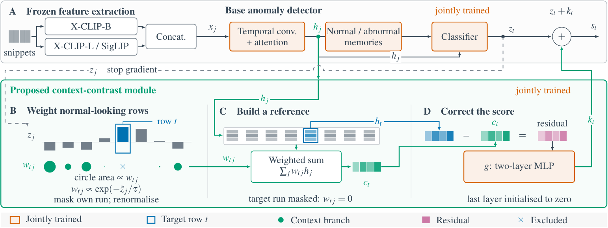
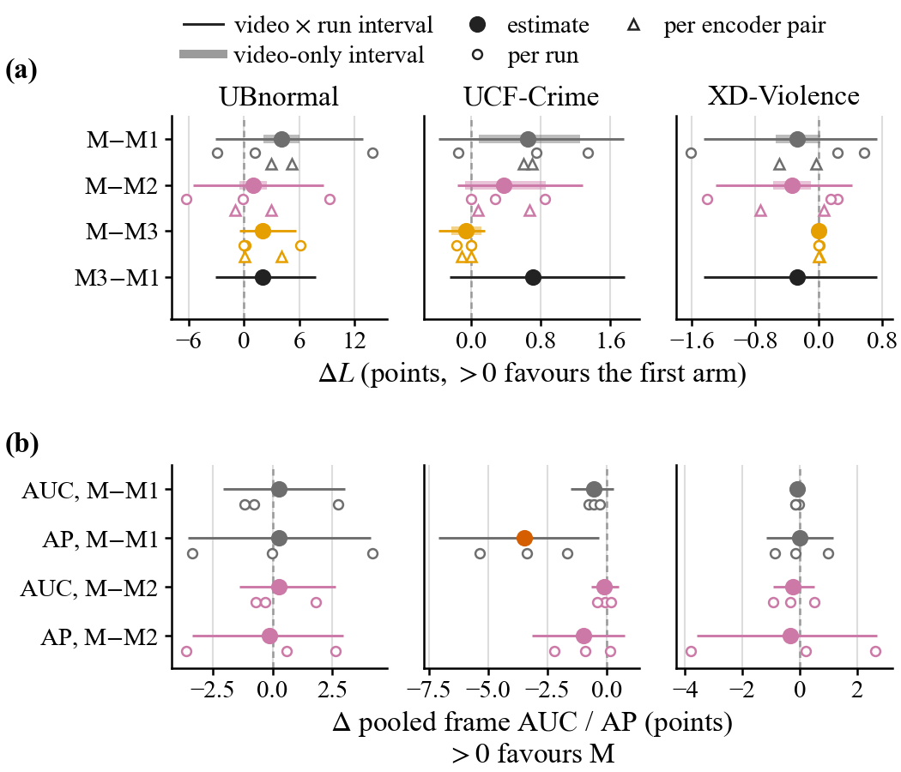
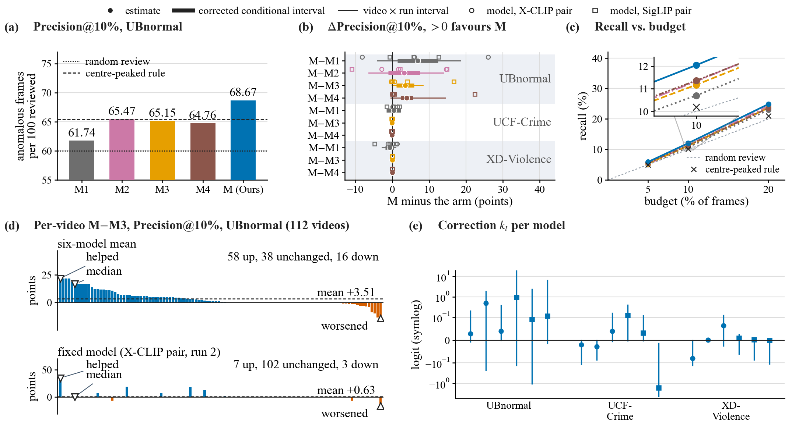
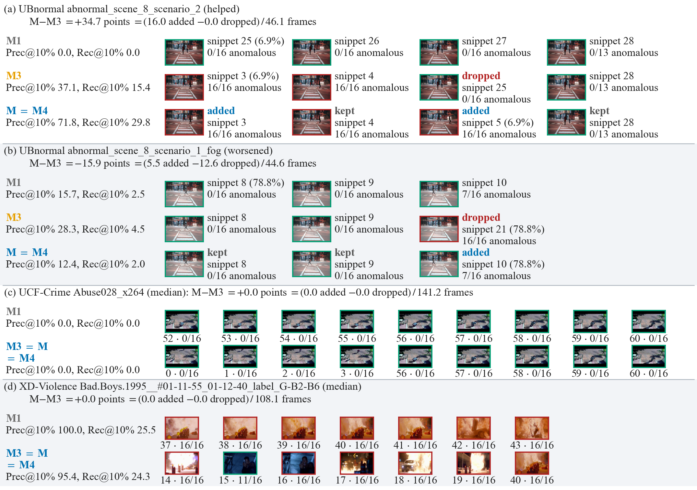

# NWCC

NWCC (normality-weighted context contrast) for weakly supervised video anomaly localisation on frozen vision-language features. NWCC is added to a published base anomaly detector, UR-DMU, without changing its trunk, objective or recipe: each snippet logit is corrected by a learned residual of the difference between the snippet embedding and a normality-weighted context drawn from the same video. Features come from frozen X-CLIP (base, large) and SigLIP-so400m encoders; no encoder is fine-tuned. NWCC adds 65,793 trainable parameters to UR-DMU (0.86% / 0.84% of the detector for the two encoder pairs).



*Frozen encoders give the snippet embeddings; the base anomaly detector scores them; NWCC forms a normality-weighted context of the other snippets of the same video and adds a learned residual of the difference to each snippet logit.*

The evaluation was pre-registered and sealed: the configuration was selected on validation videos only, the base detector was chosen by a same-feature comparison of four published detectors, and UBnormal was tested once. The pre-registered criterion was **not met**. A post-hoc analysis of the completed models, kept apart from that verdict, is reported with it. The manuscript takes every number from the record files under `experiments/`; the repository is private at the time of writing, and source videos and derived UBnormal features are not redistributed (UBnormal is CC BY-NC-ND 4.0).

## Results
Within-video localisation `L` (frame AUC inside anomalous videos, mean over 3 training runs x 2 encoder pairs) and the pre-registered contrasts with 95% video-by-run bootstrap intervals, UBnormal test set (`experiments/E024_localisation_method/results/e024_stage3.json`):

| Arm | `L` | Contrast | Estimate | 95% interval | Class |
|---|---|---|---|---|---|
| NWCC on UR-DMU (P) | 65.96 | P − UR-DMU | +4.06 | [−3.13, +12.94] | inconclusive |
| UR-DMU (U) | 61.90 | P − training-only control | +0.95 | [−5.58, +8.61] | inconclusive |
| training-only control (C6) | 65.01 | P − same checkpoints, correction off | +2.04 | [−0.48, +5.64] | inconclusive |

Both pre-registered contrasts include zero, so the criterion (lower bound > 0 for both) was not met. On the auxiliary UCF-Crime and XD-Violence readings every `L` contrast is inconclusive and the correction at inference changes `L` by −0.06 and +0.00 points.



*Per-run contrasts in `L` with their intervals: (a) the confirmation on UBnormal, (b) the auxiliary readings. Values above zero favour the first arm of each contrast.*

Post-hoc, exploratory (`posthoc_20261026/results.json`, `posthoc_20261027/results.json`): on the completed UBnormal models the share of anomalous frames among the top-ranked 10% of each anomalous video (Precision@10%) is 61.74 (UR-DMU), 65.15 (same checkpoints with the correction off) and 68.67 (NWCC). The NWCC gain over the correction-off scoring is +3.51 with the family-corrected interval [+1.10, +5.93] conditional on the trained models and [−0.04, +8.34] when training runs are resampled. Replacing the normality weights by uniform weights on the same checkpoints gives 64.76 (−3.90). These are observations on six trained models, not a confirmed effect of retraining.



*Review-budget metrics on the completed models: Precision@10% per arm, the contrasts with both interval kinds, recall against the review budget, and the per-video change.*



*The snippets each arm would put in front of a reviewer for one fixed model per benchmark (top-ranked 10% of the video); frames are from the UBnormal, UCF-Crime and XD-Violence test videos.*

## Repository layout
| Path | Contents |
|---|---|
| `src/wvad/` | the library: `extract/` (dense snippet features), `prep/`, `data/` (manifests, UBnormal), `baselines/` (ported detectors; `urdmu.py` and NWCC in `urdmu_k.py`), `diagnostics/e02*.py` (the experiment commands), `eval/` |
| `data/` | manifests, splits and small annotation tables (sha256 in `data/SHA256SUMS`); features and videos stay outside the repository ([`data/README.md`](data/README.md)) |
| `experiments/E021_…`, `E022_…` | records of the feature extraction (training split, test splits): gates, environments, access logs |
| `experiments/E023_localisation_baselines/` | the base detector comparison: plan, selection, gates, `results/e023_summary.json`, `e023_runs.csv` |
| `experiments/E024_localisation_method/` | NWCC: plans (`stage0/`, `stage1/`, `stage3/`), development result `results/e024_stage1.json`, the sealed result `results/e024_stage3.json` + `e024_stage3_runs.csv`, the two post-hoc rounds, the data-figure cases |
| `configs/paths.example.yaml` | copy to `configs/paths.yaml` (git-ignored) and point it at the local folders |
| `figures/` | the four figures shown above (PNG renders of the manuscript figures) |

Every experiment folder holds its `PLAN.md` (sealed by the commit that adds `PLAN.sha256` alone), its small result files and its report ([`experiments/README.md`](experiments/README.md)). The development history before these four experiments (E001–E020, P000) was removed from the tree on 2026-10-28 and remains in the commit history; nothing in the manuscript rests on it.

## Setup
```bash
pip install torch                                  # CUDA build of your choice
pip install -e ".[dev]"                            # training, scoring, analysis
pip install -e ".[extract]"                        # feature extraction (pinned transformers / opencv / numpy)
cp configs/paths.example.yaml configs/paths.yaml
```
`configs/paths.yaml` needs `feature_root` (where the feature caches are written), `raw_video_root` (the folder holding `Anomaly-Detection-Dataset/`, `XD-Violence/` and `UBnormal/`) and the annotation paths. Commands run from the repository root with `PYTHONPATH=src`; on a shared GPU server also `OMP_NUM_THREADS=4 MKL_NUM_THREADS=4 KMP_DUPLICATE_LIB_OK=TRUE`. All training runs below are deterministic (`--deterministic` with `CUBLAS_WORKSPACE_CONFIG=:4096:8`).

## Reproduction
`<runs>` is a folder outside the repository; `<raw>` is `raw_video_root`. Each command logs the videos it opens.

**1. Features.** Gap-free 16-frame snippets of the training split (phases `val`, the held-out training videos, and `trainpart`), then the 32-unit caches derived from them; the test splits through the access device of E022, which records the read.
```bash
for ds in ucf xdv; do
  python -m wvad.extract header --dataset $ds --access_log <runs>/access.csv --out <runs>/header_$ds.csv
  python -m wvad.extract dense  --dataset $ds --phase val       --access_log <runs>/access.csv
  python -m wvad.extract dense  --dataset $ds --phase trainpart --access_log <runs>/access.csv
  python -m wvad.extract derive --dataset $ds --stage 2
done
A="--test_log <runs>/test_access.log --record <runs>/gate.json --selection_sha256 <sha256 of results/e022_selection.json> --freeze_commit <E022 freeze commit>"
python -m wvad.extract.testsplit header $A --video_log <runs>/video_access.csv --out <runs>/header_test.csv
python -m wvad.extract.testsplit dense  $A --video_log <runs>/video_access.csv --access_log <runs>/extract_access.csv
python -m wvad.extract.testsplit derive $A
```
**2. UBnormal.** Unpack the archive under `<raw>/UBnormal/Scene<s>/`, fetch the six official split lists, build the manifests (`data/manifests/ubn_*.json`, no test intervals), extract the dense stores.
```bash
unzip -q <raw>/ubnormal/UBnormal.zip -d <raw>/UBnormal
for f in normal_training abnormal_training normal_validation abnormal_validation normal_test abnormal_test; do
  curl -sS -o <raw>/ubnormal_meta/${f}_video_names.txt https://raw.githubusercontent.com/lilygeorgescu/UBnormal/main/scripts/${f}_video_names.txt; done
python -m wvad.prep.ubnormal manifests --lists <raw>/ubnormal_meta --access_log <runs>/access.csv
python -m wvad.extract header --dataset ubn --access_log <runs>/access.csv --out <runs>/header_ubn.csv
python -m wvad.extract dense  --dataset ubn --phase val       --access_log <runs>/access.csv
python -m wvad.extract dense  --dataset ubn --phase trainpart --access_log <runs>/access.csv
python -m wvad.prep.ubnormal extract-test --access_log <runs>/access.csv
```
**3. Training inputs of the detectors.** Each ported recipe trains on its official unit, derived from the snippets of the training split: `d16m32l2` (MIL), `d16m32` (RTFM), `d16m200` (UR-DMU and NWCC), `d16p256` (VadCLIP visual branch).
```bash
for ds in ucf xdv; do python -m wvad.extract.derive_n --dataset $ds --variants d16m32l2 d16m32 d16m200 d16p256 --record <runs>/e023_train_inputs.json; done
python -m wvad.extract.derive_n --dataset ubn --variants d16m200 --record experiments/E024_localisation_method/results/e024_stage3_train_inputs.json
```
**4. Base detector comparison (E023).** One chain = one method, dataset, encoder pair and seed at the official recipe (`--lr_mult`, `--scale_mult` from the validation check recorded in `results/e023_devlr.json`). Validation scoring and selection, then the single sealed test read and the analysis.
```bash
python -m wvad.baselines.train --method urdmu --unit 200 --dataset ucf --pair xcb_xcl --seed 42 \
    --lr_mult 1 --scale_mult 1 --n_chunk 4096 --deterministic --out_dir <runs>/e023/ucf_xcb_xcl_s42/urdmu_u200
#   likewise --method mil --unit 32 | rtfm --unit 32 | vadclip_v --unit 256, datasets ucf xdv, pairs xcb_xcl xcb_siglip
python -m wvad.diagnostics.e023_score score  --split val  --runs_root <runs>/e023 --out <runs>/e023_scores --family "mil rtfm urdmu vadclip_v"
python -m wvad.diagnostics.e023_score select --runs_root <runs>/e023 --scores <runs>/e023_scores --family "mil rtfm urdmu vadclip_v"
python -m wvad.diagnostics.e023_score score  --split test --runs_root <runs>/e023 --out <runs>/e023_scores --test_log <runs>/e023/test_access.log \
    --selection_sha256 <sha256 of results/e023_selection.json> --all_ckpts_sha256 <sha256 of results/e023_all_ckpts.json> \
    --memory_need_gb <gate (m) value> --n_chunk 4096 --freeze_commit <E023 freeze commit>
python -m wvad.diagnostics.e023 analyze --runs <runs>/e023 --scores <runs>/e023_scores --e022_scores <runs>/e022_scores --test_log <runs>/e023/test_access.log
```
Result: `results/e023_summary.json`, `results/e023_runs.csv`. UR-DMU had the highest `L` on both datasets and became the base detector.

**5. NWCC (E024).** The NWCC configuration (ρ global, τ = 0.25) and the final control (training-only) were chosen on validation data in stage 1 (`stage1/PLAN.md`, `results/e024_stage1.json`); the confirmation then trained UR-DMU, NWCC and the control with new seeds on UBnormal, UCF-Crime and XD-Violence and read the test sets once.
```bash
# development, validation only (stage 1): one NWCC chain, its bit-for-bit re-scoring, the analysis
python -m wvad.diagnostics.e024_stage1 train   --dataset ucf --pair xcb_xcl --seed 0 --rho g --tau 0.25 --mode k --out_dir <runs>/e024/stage1/ucf_xcb_xcl_s0/k_rg_t0.25
python -m wvad.diagnostics.e024_stage1 rescore --chain <runs>/e024/stage1/ucf_xcb_xcl_s0/k_rg_t0.25
python -m wvad.diagnostics.e024_stage1 analyze --u_runs <runs>/e024/stage0 --runs <runs>/e024/stage1
# confirmation (stage 3): per cell <ds> in ubn ucf xdv, <pair> in xcb_xcl xcb_siglip, <seed> in 3 4 5
#   (m = the UBnormal learning-rate multiplier of results/e024_stage3_inputs.json, 1 on the other datasets)
python -m wvad.baselines.train --method urdmu --unit 200 --dataset <ds> --pair <pair> --seed <seed> --lr_mult <m> --scale_mult 1 \
    --n_chunk 4096 --deterministic --out_dir <runs>/e024/stage3/<ds>_<pair>_s<seed>/urdmu_u200
python -m wvad.diagnostics.e024_stage3 train --dataset <ds> --pair <pair> --seed <seed> --arm p  --lr_mult <m> --scale_mult 1 --out_dir <runs>/e024/stage3/<ds>_<pair>_s<seed>/k_rg_t0.25
python -m wvad.diagnostics.e024_stage3 train --dataset <ds> --pair <pair> --seed <seed> --arm c6 --lr_mult <m> --scale_mult 1 --out_dir <runs>/e024/stage3/<ds>_<pair>_s<seed>/ctl_trainonly_rg_t0.25
python -m wvad.diagnostics.e024_stage3 gates      --runs <runs>/e024/stage3
python -m wvad.diagnostics.e024_stage3 score-test --runs <runs>/e024/stage3 --out <runs>/e024/stage3_scores --access_log <runs>/e024/stage3/test_access.csv --freeze_commit <E024 stage-3 freeze commit>
python -m wvad.diagnostics.e024_stage3 analyze    --runs <runs>/e024/stage3 --scores <runs>/e024/stage3_scores --access_log <runs>/e024/stage3/test_access.csv
```
Result: `results/e024_stage3.json` (outcome row `not_met`) and `results/e024_stage3_runs.csv`.

**6. Post-hoc analysis.** Re-score the completed NWCC checkpoints with uniform context weights, then compare every arm with four untrained temporal rules on the review-budget metrics.
```bash
python -m wvad.diagnostics.e024_posthoc score-uniform --runs <runs>/e024/stage3 --scores <runs>/e024/stage3_scores --out <runs>/e024/posthoc_uniform --access_log <runs>/e024/posthoc_access.csv
python -m wvad.diagnostics.e024_posthoc analyze       # -> experiments/E024_localisation_method/posthoc_20261027/results.json
```

## Protocol notes
- Model, checkpoint and hyperparameter choices used only held-out training videos. UBnormal was read once, by the sealed `score-test`. The UCF-Crime and XD-Violence test splits were read three times across E022, E023 and the E024 auxiliary reading (non-independent; recorded in the plans).
- Each plan was frozen before its runs: the commit that adds `PLAN.sha256` alone is the freeze commit, and the scoring and analysis commands refuse to run unless the deployed code is that commit or a descendant that changed none of its fixed files.
- The gate-by-gate procedure of each experiment (environment records, bit-for-bit re-scoring, access logs) is in its `PLAN.md`; the result files were produced by exactly those commands.
- On this tree the analysis commands of E021–E024 cannot be re-run: their lineage checks read records removed on 2026-10-28, and the frozen-`src/` rule no longer holds. The committed results do not need a re-run; if one is wanted, use a checkout at or before commit `84c04fb`.

## Paper
The manuscript and its figure and number generators are kept local until submission ([`paper/README.md`](paper/README.md)). Every value in it is a macro generated from the record files above.

## Local checks (not tracked)
```bash
pytest            # unit tests in tests/
ruff check .
```

## License
MIT (see [LICENSE](LICENSE)). Third-party annotations and datasets keep their own licenses.
